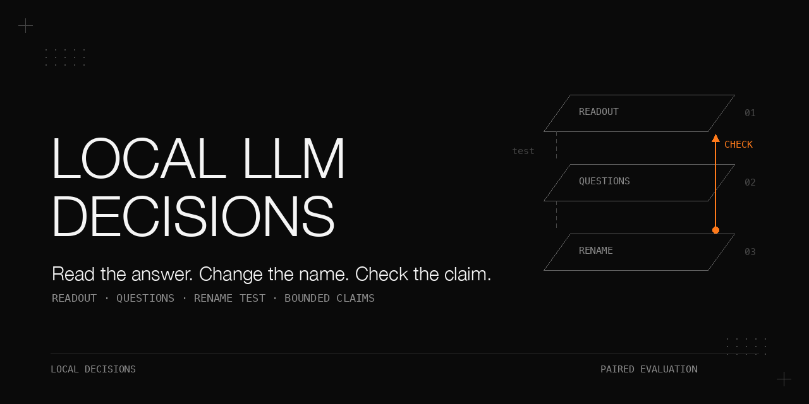

# A small local model as a decision-maker

Read the first-token distribution, ask literal questions, and test whether a changed name changes the answer.
A small local model can make a bounded decision inside a larger process when its uncertainty is measured,
its thresholds and composition stay in code, and its evaluation tests suspected shortcuts.
The evidence here is deliberately mixed: a readout selected the correct handler in 19/20 cases when it was
among the candidates, but failed the confidence gate. A fine-tuned encoder reached template accuracy
1.000, then flipped 16/48 decisions when only names changed. Rename augmentation reduced that count to
0/48 on the tested transform while recall fell from 6/7 to 4/7. These are small, private-data studies,
not independently confirmed general results.

## Why this matters

A correct top answer does not make its probability trustworthy. A perfect confusion matrix does not
show which input feature the model read. And a model that identifies a task template cannot replace
mechanical checks on what an action is allowed to change.
This book follows those distinctions through the measurement code, negative results, and a claim ledger.
The public kit contains invented English data and mocks; no private records, real row labels or weights.

## What is in this book

1. [Read the decision off the first token](docs/first-token-readouts.md): option distributions, calibration metrics, and probability jitter.
2. [Ask literal questions](docs/literal-questions.md): a yes/no battery with thresholds and composition held in code.
3. [Fine-tune and measure what it bought](docs/fine-tuning.md): the training objective, calibration failures, domain pre-training, and serving skew.
4. [The rename test](docs/rename-test.md): paired perturbations, augmentation, and the limits of an apparent fix.
5. [Small-sample arithmetic](docs/small-samples.md): exact intervals, zero-event bounds, and supported versus unsupported claims.

[All tables](docs/results.md) preserve the historical numbers and conditions.
[Expanded pitfalls](docs/pitfalls.md) connect symptoms to causes and fixes.

## The setting

| Item | Recorded setting |
|---|---|
| Dates | Readout 2026-09-22; battery and fine-tuning 2026-09-27; rename test 2026-09-28; derived figures recomputed in 2026-10 |
| Readout serving | Qwen3.8-Flash-Next, vLLM tensor-parallel across two Dell Pro Max with GB10 machines; live production traffic throughout; exact engine build not recorded |
| Large local battery arm | DeepSeek V4 Flash-class vision-experimental model, vLLM, thinking off, one first-token request per question |
| Training and decision-model evaluation hardware | a local GPU |
| Training software | Python 3.11, `laya==0.3.20`, `torch` 2.14, single-process fp32; other dependency versions not recorded |
| Small models | Laya `convaiinnovations/laya`, `multilingual`, 421M-parameter ModernBERT-family encoder; Kev `jaredpalmer/kev-0.8b`, Qwen3.5-Base 0.8B plus LoRA and a pointer head |
| Dependencies | Readout, battery, mocks and statistics use Python standard library; training also needs `laya`, `torch`, `safetensors`, `transformers` |
| Private data | 321 cards: 230 English, 91 mixed-language; 57 sensitive rows stayed local; separate readout sets contain 37 routing and 108 verdict items |
| Public data | Invented fixtures only; dimensions deliberately resemble the study, but contents and labels are synthetic |

Local-model readouts were used only as candidate pre-labels. Gold labels were assigned
against a written rubric, with a 50-row blind check.
Fast-path eligibility agreed on 43/50 (0.86), above its 0.85 gate.
Task shape agreed on 35/50 (0.70); a tightened rubric with 8 numbered rules led to 11 re-adjudications,
with 4 disagreements retained and explained. Delivery type agreed on 44/50 (0.88).
The [complete label agreement table](docs/results.md) also reports the unused targets.

Laya and Kev were recorded as Apache-2.0 projects. Exact upstream commits, licence texts and the Laya
notebook URL were not archived; verify these before redistributing third-party material.
No model downloads, upstream libraries or weights are bundled here.

## Chapter 1: Read the decision off the first token

**Problem.** Can an already-serving model provide a useful decision and a probability reliable enough to act on?

**Mechanism.** Request chat completions with `max_tokens=2`, `temperature=0`, `logprobs=true`,
`top_logprobs=20`, and `chat_template_kwargs.enable_thinking=false`.
Use letters for routing and `Yes`/`No` for verdicts. Cap candidates at 25 and append an escape option.
For each option, keep the maximum logprob among tokens matching after trimming and lowercasing.
For an absent option use `min(observed logprob) - 3.0`; softmax only over allowed options.
This is an option-conditioned distribution, not the probability mass of the complete vocabulary.

Score accuracy, summed multiclass Brier, ECE over 10 equal-width confidence bins, HCER at confidence
at least 0.90 with its denominator, and coverage at a 5 % error budget.
For coverage, sort by confidence and scan every prefix: cumulative error is not monotone.
Map `APPLY/REJECT` to `Yes/No` before building targets.
Retry transport and semantic failures up to 3 attempts with 2 s back-off and a 120 s timeout.
Save failures explicitly; reverse candidate order and compare chosen names, not letters.

**Procedure as run, 2026-09-22.** Initial runs used 4 workers; sequential controls used 1.
The formal result used three sequential runs of both sets, 145 requests each, about 49 s per run.
Requests were under 2K prefill tokens, and the endpoint carried production traffic throughout.
Independent recomputation matched all 12 result groups to three decimals and all 799 reconstructed distributions.
Historical files saved raw logprobs but neither request text nor hashes; request identity was inferred from construction.

Conditions: formal three-run medians, ranges in parentheses; one worker, production traffic.

| Set | n | Accuracy | Brier | ECE | HCER@0.9 | Coverage @5 % |
|---|---|---|---|---|---|---|
| Routing | 37 | 0.784 (0.784-0.811) | 0.336 (0.331-0.356) | 0.149 (0.145-0.153) | 0.100 (0.069-0.107) | 0.541 (0.432-0.541) |
| Verdicts | 108 | 0.657 (0.648-0.685) | 0.449 (0.440-0.472) | 0.079 (0.075-0.119) | 0.077 (0.000-0.111) | 0.102 (0.028-0.111) |

Routing HCER denominators were 29 / 28 / 30; rates were 0.069 / 0.107 / 0.100.
The design gate required accuracy at least 0.85 and no worse than the incumbent, Brier at most 0.12,
ECE at most 0.05, confident error at most 3 %, and coverage at least 40 %.
The gate was not calibrated to the local cost of an error. Neither set passed.
The verdict baseline row is ambiguous: 0.657 exceeds its 0.5 majority baseline, although the original report marked every condition failed.

**What did not work.** When the correct handler was available, the readout was right 19/20 in all seven runs
(incumbent 9/20). When it was missing, escape was correct only 1/7 in six runs and 2/7 in one.
Raw logprobs matched in 0/37 and 0/108 between runs; sequential requests did not remove the variation.
Four routing runs held accuracy at 0.784 while HCER ranged from 7 % to 14 % and coverage from 19 % to 57 %.
The serving cause was not isolated. A separate candidate-acceptability question and retrieval expansion were designed, not run.

**Rule.** Guarantee candidate coverage, calibrate escape, and report calibration over at least three runs with median and range.
[Full method, gate table, breakdowns and controls](docs/first-token-readouts.md).

## Chapter 2: Ask literal questions, not a 24-way one

**Problem.** A task gate must choose fast, full process or review. A 24-way task-shape question performed poorly.

**Mechanism.** Keep goal, task and note; remove the hand-written shape line that leaked or argued for a label.
Ask seven literal questions: writes, deterministic, egress, shared production, judgment, long GPU work,
and exact template membership. Each boolean question has an instruction and true/false criteria.
The initial risk and execution-lane questions were removed from the decision.

The public registry uses an invented changelog merge template. With `review=0.35`, `action=0.70`:

```text
Any hard-block probability >= action                 -> full
Any hard-block probability in [review, action)       -> review
Any template probability >= action                  -> fast
Any template probability in [review, action)         -> review
Otherwise                                           -> full
```

Hard blocks are egress, shared production, judgment and long GPU work.
`writes` and `deterministic` are measured but do not enter this composition.
The template's mechanical check supplies verifiability; deterministic checks must enforce release boundaries.
The thresholds came from a public cookbook pattern, not a fit to these data.

**Procedure as run, 2026-09-27.** Split 321 time-ordered cards by project group, nominally 70/15/15:
dev 227, sel 46, test 48. Pre-label, adjudicate, blind-check, tighten the rubric, and recompute corrected scores.
Score zero-shot shape arms with at least three runs; then score the battery and fine-tuned arms.
Test was withheld during training but later used to select the model.

Conditions: the same 48 test rows, corrected gold labels; this comparison is **not like-for-like**.

| Condition | Local 24-way shape | Local template yes/no |
|---|---|---|
| Model | Laya fine-tuned, 4 epochs | Laya fine-tuned, 6 epochs |
| Accuracy | 0.333 | 1.000 |
| Chance / majority | 0.042 / 0.208 | majority 0.854; 7 positives of 48 |
| Input | hand-written shape line present | shape line stripped |
| Training label space | 24 classes; 6 of 20 present dev classes under 5 examples | one binary question; 24 positives in dev |

Task, label space, baseline, input card and epochs changed together. These numbers do not establish a causal gain from recasting.

Conditions: composed decisions on test, 9 positives of 48; default thresholds, corrected labels.

| Arm | Precision | Recall | Fast | Review | False fast |
|---|---|---|---|---|---|
| Large local readout | 0.00 | 0.00 | 1 | 16 | 1 |
| Laya zero-shot | 0.50 | 0.111 | 2 | 7 | 1 |
| Kev-0.8B zero-shot | none | 0.00 | 0 | 44 | 0 |
| Laya fine-tuned | 1.00 (6/6) | 0.667 (6/9) | 6 | 8 | 0 |
| Kev-0.8B fine-tuned | 1.00 (5/5) | 0.556 (5/9) | 5 | 15 | 0 |
| Laya domain-pre-trained then fine-tuned | 0.857 (6/7) | 0.667 (6/9) | 7 | 4 | 1 |

**What did not work.** The reported zero-shot shape accuracies were 0.209, 0.178 and 0.162 on 321 rows.
Hard-block accuracies remained near majority baselines; one served production-change probe received 0.02 for shared production.
A good offline score also failed all 3 first serving probes because prefixes and question wording differed.
After restoring the training format, positive probes scored 0.97 and reached fast.

**Rule.** Ask literal questions, keep composition in code, share the input builder and question registry,
and print the majority baseline alongside accuracy. [All questions, arms and threshold fits](docs/literal-questions.md).

## Chapter 3: Fine-tune on your own labels, and measure what it bought

**Problem.** Zero-shot probabilities either fell in the review band or confidently favoured the wrong answers.

**Mechanism.** Expand each typed JSONL card into one item per question.
The Laya port follows the upstream notebook: proper-scoring reward, a GRPO-style policy-gradient term,
and soft cross-entropy on one-hot targets. Use sequence length 1024, head budget 256, gradient checkpointing,
AdamW with weight decay 0.01, encoder learning rate 2.5e-5, head rate 4x, batch 8 and accumulation 4.
Clip gradients at 1.0 and use a cosine schedule to 1e-6.
Use 4 zero-mean logit perturbations, with noise sigma annealed from 0.4 to 0.1.
Fit a scalar temperature per question type on sel, clamp to [0.1, 10], and remove inherited per-option-count temperatures.
Export half-precision weights, encoder config, tokenizer and `rl_agent_config.json`; reload before claiming a usable export.

**Procedure as run, 2026-09-27.** Train Laya on 227 rows x 7 questions for 6 epochs, temperature-fit on 46 sel rows;
train Kev-0.8B for 2 epochs at learning rate 2e-5, fp32, batch 1. Score with three inference runs and their median.
Compare threshold fitting, Platt maps and domain pre-training on the 48 test rows; serve the selected model in shadow mode only.

Conditions: Laya Platt fit on 46 sel rows; test evaluation, corrected labels.

| Measure | Raw | Platt |
|---|---|---|
| writes confident errors / answers | 15/40 | 0/0 |
| judgment confident errors / answers | 10/41 | 0/0 |
| gpu_long confident errors / answers | 7/46 | 8/46 |
| template confident errors / answers | 0/46 | 0/46 |
| Composed precision / recall / fast | 1.00 / 0.67 / 6 | 1.00 / 0.56 / 5 |

Conditions: one domain pre-training run, one seed; same test set and subsequent battery fine-tuning.

| Arm | Template accuracy | Composed precision / recall |
|---|---|---|
| Battery fine-tuning only | 1.000 (0/46 confident errors) | 1.00 / 0.667 |
| Domain pre-training then fine-tuning | 0.833 (5/43 confident errors) | 0.857 / 0.667 |

The private notes corpus was 8.3 MB: 2,177 pages, 49,934 paragraphs, 6,547 sensitive paragraphs removed.
The masked-language step used one epoch, learning rate 5e-5, max length 256, mask probability 0.15, batch 16.
The pre-set gate was precision at least 0.98 and the three weakest questions at least 5 points better; it failed.

**What did not work.** Threshold fitting erased review in 4 of 5 arms where a fit existed.
An initial precision-collapse claim depended on one disputed label; the structural finding survived correction.
Platt mostly removed confidence rather than mistakes, cost recall, and worsened `gpu_long`.
The served model's fitted temperature reached 10.0. Domain pre-training was not adopted; its general effect remains unknown.

**Rule.** Compare against majority baselines and do not fit thresholds or calibration on fewer than about 50 positives.
That is a study rule of thumb, not a demonstrated universal sample-size threshold.
[Training details, complete calibration tables and dependency limits](docs/fine-tuning.md).

## Chapter 4: The rename test

**Problem.** Did template accuracy 1.000 reflect the task description or the shared project-name prefix?

**Mechanism.** Copy each test row and change only the first-line name.
Give positives non-template names and negatives template-style decoys. Pair by row identity, compare
`p(template) >= 0.70`, and record the largest absolute probability change.
Strictly reject missing, non-finite or out-of-range probabilities and non-boolean labels.
Save row-level outputs so equal confusion matrices cannot hide exchanged errors.

**Procedure as run, 2026-09-28.** After live probes exposed the shortcut, add 2 renamed copies of each positive
and decoy-name copies of 70 training negatives and 14 hold-out negatives.
Training grew from 227 to 345 rows; hold-out from 46 to 68; positives from 24 to 72.
Retrain with the same script, hyperparameters and seed. Score the original 48 rows, their rename copy,
and 16 hand-written probes, of which 14 have a defined template label.
Update only the shadow service; recommendations remain deterministic registry matches.

Conditions: template threshold 0.70; original test has 7 positives; probe has 6 positives and 8 negatives.

| Model | Set | TP | FP | FN | TN | Precision | Recall |
|---|---|---|---|---|---|---|---|
| Original | test | 6 | 0 | 1 | 41 | 1.00 | 0.86 |
| Original | rename | 0 | 10 | 7 | 31 | 0.00 | 0.00 |
| Original | probe | 2 | 2 | 4 | 6 | 0.50 | 0.33 |
| Retrained | test | 4 | 0 | 3 | 41 | 1.00 | 0.57 |
| Retrained | rename | 4 | 0 | 3 | 41 | 1.00 | 0.57 |
| Retrained | probe | 4 | 0 | 2 | 8 | 1.00 | 0.67 |

Conditions: paired original and rename rows, 48 pairs, same transform family used in augmentation.

| Model | Decisions flipped | Largest absolute probability change |
|---|---|---|
| Original | 16 (6 positives lost + 10 negatives gained) | 0.983 |
| Retrained | 0 | 0.115 |

**What did not work.** This is robustness to one transform, not general name invariance.
Augmentation also raised the positive share from 24/227 = 10.6 % to 72/345 = 20.9 %, increased updates,
and changed the temperature-fitting hold-out. Recall fell from 6/7 to 4/7.
Judgment recall was only 4/13 on test and 1/5 on probes; accuracy obscured that weakness.

**Rule.** Perturb only the suspected feature, retain row pairing, and count flips alongside probability changes and accuracy.
[Probe aggregates, lost positives, strict parsing and augmentation confounds](docs/rename-test.md).

## Chapter 5: Small-sample arithmetic and a claim ledger

**Problem.** Test sets with 7 to 9 positives cannot establish precise recall or a low false-positive rate.

**Mechanism.** Invert binomial tails for exact two-sided 95 % Clopper-Pearson intervals.
For zero events use the one-sided bound `1 - 0.05^(1/n)`; the required sample size for bound `b` is
`ceil(ln 0.05 / ln(1 - b))`. Compute exact two-sided McNemar from discordant paired counts.

**Procedure as run.** Derived figures were recomputed in 2026-10 from saved outputs; the first seven entries
in the complete interval table matched an independent review calculation. The supplied stdlib helper recomputes them offline.

Conditions: recomputed exact intervals, or explicitly one-sided bounds; study observations, not synthetic scores.

| Quantity | Observation | 95 % interval or bound |
|---|---|---|
| Retrained test recall | 4/7 | 0.184 to 0.901 |
| Original test recall | 6/7 | 0.421 to 0.996 |
| Retrained test false positives | 0/41 | one-sided upper 7.05 % |
| Retrained probe false positives | 0/8 | one-sided upper 31.2 % |
| Rename flips after retraining | 0/48 | one-sided upper 6.05 %; variants are not independent tasks |
| Fast-path precision | 6/6 | one-sided lower 0.607 |
| Paired positive discordance | 3 vs 1 | McNemar p = 0.625 |

**What did not work.** Zero observed errors was mistaken for evidence of a low rate; a non-significant recall
test could neither prove nor rule out loss. With about 29 confident answers, one error is already 3.4 %,
so a 3 % gate effectively requires zero errors. An approximately +/- 10-point recall interval near 0.67
would need about 85 positives by normal approximation.

**Rule.** State the bound and the experiment that would change the claim.
[Complete intervals and arithmetic](docs/small-samples.md).

## Pitfalls

| Symptom | Root cause | Fix |
|---|---|---|
| Binary Brier 0.632 | `APPLY/REJECT` compared with `Yes/No` | Map targets; corrected first-run Brier 0.448 |
| Coverage reported as zero | Scan stopped at the first failing prefix | Scan all prefixes |
| Failed reverse request counted as agreement | Failure and escape both became null | Compare valid pairs and report failures |
| Every request failed but metrics show zeros | Empty metrics dropped failure counts | Preserve counts and undefined metrics |
| Serving misses after strong offline results | Card prefixes and question wording changed | Share builder and registry |
| Perfect held-out template accuracy | Shared name prefix survived group splitting | Paired name perturbation |
| Equal matrices called invariant | Row identity was discarded | Save and compare per-row probabilities |
| Missing probability becomes negative | Parser defaulted to zero | Reject missing, invalid and non-finite values |

The [expanded pitfalls](docs/pitfalls.md) include every recorded failure and remaining limitation.

## Reproduce it without our infrastructure

These steps exercise mechanics with synthetic fixtures. They do not recreate the historical scores.
First change to the repository root (replace the placeholder with your checkout):

```bash
cd /path/to/local-llm-as-decision-maker
```

Outputs and temporary work stay under the requested repository output directory.
No packages or weights are needed for the standard-library route.

1. Run the offline tests, which cover serialized mock HTTP requests, retries, metrics, composition, pairing and bounds:

   ```bash
   PYTHONDONTWRITEBYTECODE=1 python3 -m unittest discover -s tests -v
   ```

2. Regenerate the invented fixtures if desired, then run the integrated offline demonstration:

   ```bash
   python3 scripts/make_fixtures.py --out fixtures
   python3 scripts/run_offline.py --out results/offline --transport inprocess
   ```

   This uses the HTTP handler in memory, runs selftest and the three-run wrapper, rescoring,
   the battery arms and scoring, threshold fitting, Platt calibration, augmentation and paired stub evaluation.
   `--transport inprocess` sets the mock mode internally and needs no running server.
   Use `--transport loopback` for an automatically started mock on a free loopback port if binding is permitted.
   Successful requests have no back-off delay, including jitter and order ablation;
   the 2 s back-off applies only between failed attempts. No fixed runtime is claimed.
   Name-reading and content-reading stubs are programmed behaviours;
   their difference is not evidence that augmentation trained a real model successfully.

   To run just the three-run wrapper without a server, set its mock mode explicitly:

   ```bash
   COOKBOOK_MOCK_MODE=clean bash scripts/run3.sh --data fixtures --base http://127.0.0.1:8000 --model mock --limit 3
   ```

3. Inspect per-request distributions and hashes, then recompute a summary into a separate directory:

   ```bash
   python3 scripts/decide.py --metrics-only results/offline/readout/run1 --out results/recomputed --model mock
   python3 scripts/stats.py
   ```

4. To inspect a mock manually, first run `python3 scripts/mock_server.py --mode jitter --port 0` in a separate terminal.
   Point `scripts/decide.py --base` at the loopback URL printed by the server, with `--model mock`.
   For `scripts/run3.sh` against that server, unset `COOKBOOK_MOCK_MODE` first and pass the same `--base`.
   The server defaults to port 8000; `--port 0` selects a free port to avoid conflicts.
   `clean` returns fixed probabilities; `jitter` changes confidence without changing top options;
   `none-logprobs` exercises semantic failure. This reproduces a metric failure pattern, not its production cause.

5. For real CPU fine-tuning, first supply local dependencies matching [the recorded pins](configs/requirements-finetune.txt)
   and a local Laya checkpoint, then run `scripts/smoke_test.py --base models/laya`.
   Follow [the training commands](docs/fine-tuning.md) for synthetic battery training and the DAPT smoke.
   Evaluate the resulting checkpoint with `arm_battery.py --arm laya` and `eval_v2.py --model`.
   This path was not run as part of the offline checks.

The actual serving build, upstream notebook revision, other dependency versions and Kev training-export
schema are unknown. No installation or model download is part of this offline reproduction.

## Limits and open questions

| Claim | Supported? | Evidence | What is missing |
|---|---|---|---|
| A first-token readout from a production model picks the right option when it is among the candidates | Yes, on a small set | 19/20 in all 7 runs; incumbent 9/20 | A larger independent set; a different model |
| The readout's confident answers are too often wrong to act on | Yes | HCER 0.100 (0.069-0.107) vs 3 % gate, 3 runs | A calibration-layer ablation on the same base model with 300-500 labels |
| The same request produces different probabilities | Yes (raw logprobs differed in every item of every comparison) | 0/37, 0/108 identical; single-worker control | Request hashes in the run files; a deterministic serving configuration to test the cause |
| The cause is the serving stack (reduction order, speculative decoding, batching) | No (suspects only) | none isolated | Isolation runs |
| A 24-way label is worse than yes/no questions for a small decision model | Not established | 0.33 vs 1.000 are different tasks, base rates, inputs | Same-label-space, same-card, same-epoch comparison; stripped-card 24-way control |
| Zero-shot 24-way arms fail | Yes, on this label set | 0.16-0.21 on 321 rows | A different 24-way set |
| The fine-tuned model's template accuracy of 1.000 reflects content understanding | No | rename flips 16/48 | Independent content-only test set |
| The original model used the name as a shortcut | Yes, strongly | 16/48 flips; precision 0.00 on the rename copy; six probes | None needed for the existence claim |
| The retrained model is invariant to the name | Only for one transform | 0/48 flips on a same-type transform | Several name families (unseen prefixes, other languages, meaningless ids, missing name) crossed with the same tasks |
| The retrained model's false-positive rate is low | Weakly | 0/41, 0/8 | 299 independent negatives for a 1 % bound |
| Retraining did not cost recall | Not established, not refuted | 6/7 to 4/7, McNemar p = 0.625 | More positives; blind re-adjudication of the lost ones |
| Rename augmentation is the cause of the improvement | Not established | augmentation also changed class weight and updates | Equal-weight, equal-update control |
| The hard-block questions are a usable safety signal | No | near majority accuracy; one probe at 0.02 | n/a (design conclusion: use deterministic checks) |
| The judgment question works | No | recall 4/13 | A better-defined question and labels |
| Fine-tuning beats the other arms in general | Not established | one family, one dataset, one seed, 48 test rows | Seeds; other datasets |
| Domain pre-training hurts | Not established | one run, one seed | Replicates; task-shaped corpus |
| Threshold fitting on small selection sets is harmful | Partly | the review band vanishes in 4 of 5 fitted arms; the precision drop depended on one label | A selection set with 50 or more positives |

The complete missing-experiment list follows; none is implied complete by the mock checks.

1. **A frozen, independent, content-only evaluation set scored once**, with the labels, model, calibration and gate fixed beforehand (the existing 48-row test set was used for model selection).
2. **Negatives for a real false-positive bound:** 299 independent negatives with zero fast decisions for a 1 % one-sided 95 % bound; 2,995 for 0.1 %.
3. **A multi-name rename protocol:** each original task with several names (template family, non-template, unseen prefixes, other languages, meaningless ids, no name) crossed with the same task; report decision flips, probability change and accuracy together.
4. **The rename test on the zero-shot arms and on the fine-tuned Kev arm.** The zero-shot Kev arm scored 0.979 on the template question and the question text shares words with the name; nobody has checked whether it also reads the name.
5. **An equal-weight, equal-update control for the augmentation**, and a third arm that masks the name in both training and serving.
6. **Like-for-like comparison of 24-way versus yes/no:** the same label space, base rate, state card (with and without the hand-written shape line), epoch count and seed.
7. **Seeds:** at least three fine-tuning seeds per arm; one seed is reported everywhere.
8. **Blind re-adjudication of the three template positives the retrained model lost**, and of the disputed rows, with an "insufficient information" label separate from "false".
9. **A defined prediction target:** "this task's content is the template's job" versus "this task belongs to the template's workflow"; the augmentation's label rule assumes the first.
10. **The judgment question:** a better definition, separate labelling of the joint region (template true and judgment true), and its recall as the headline metric.
11. **Calibration ablation on the same base model:** the readout with and without temperature scaling and with an explicit "any candidate acceptable" question first, on 300 to 500 labels; the retrieval change (top 5 to top 8 with re-rank) that was designed and not run.
12. **Serving determinism:** request hashes in the run files, then a deterministic single-request configuration (no speculative decoding, fixed batch) to isolate the cause of the probability jitter.
13. **Replication on a synthetic dataset** built for the book, since the private data cannot be shared; every number in this sheet is on private data and the synthetic replication will not reproduce them.
14. **Kev-4B** was queued; no result is recorded. A larger model on the same battery is untested.
15. **Fine-tuned decision models for other conditions:** only one template and one label set were studied; other templates may have different shortcut structure.
16. The 12-epoch fine-tune note (0.26 held-out, temperature 8.8 of 10) is a secondary figure.

All historical data are private. One dataset, one fine-tuning seed and one model-selection test set
limit generalisation. Readout and rename reviews were performed by the same independent reviewer.
Labels were assigned against one written rubric with an independent 50-row blind check.
The readout build was not recorded, and its verdict input was only a sentence.
No fine-tuned model changed a production routing decision; there is no production-outcome evidence.

## Files

| Path | Purpose |
|---|---|
| `scripts/decide.py`, `scripts/run3.sh` | First-token harness, request hashes and sequential runs |
| `scripts/mock_server.py`, `scripts/mock_transport.py`, `scripts/run_offline.py` | Loopback mock and complete offline mechanics demonstration |
| `scripts/battery.py`, `scripts/arm_battery.py` | Shared English registry, composition and local arm runners |
| `scripts/merge_gold.py`, `scripts/score_arms.py`, `scripts/score_battery.py` | Group/time split, shape voting, battery and composed metrics |
| `scripts/fit_thresholds.py`, `scripts/calibrate.py` | Selection-only threshold and Platt fitting |
| `scripts/laya_ft.py`, `scripts/smoke_test.py`, `scripts/dapt_laya.py` | Offline-checkpoint training, reload smoke and masked-language continuation |
| `scripts/build_v2.py`, `scripts/eval_v2.py`, `scripts/stats.py` | Rename augmentation, strict paired evaluation and exact arithmetic |
| `scripts/common.py`, `scripts/synthetic_model.py`, `scripts/make_fixtures.py` | Strict I/O, explicit stubs and synthetic fixture generation |
| `fixtures/`, `tests/`, `configs/` | Invented inputs, standard-library checks and recorded dependency pins |
| `docs/` | Complete tables, chapter depth, pitfalls and supplied banner assets |

The public adaptation changes only the interfaces needed for safe, offline reproduction and the documented
correctness checks. [Adaptation notes](docs/adaptations.md) distinguish those changes from the historical scripts.

## Related cookbooks

- [decision-record-deidentification-gates](https://github.com/ryangu00/decision-record-deidentification-gates): record preparation, self-disagreement and a weaker routing shortcut signal.
- [local-llm-bakeoff-measurement-pitfalls](https://github.com/ryangu00/local-llm-bakeoff-measurement-pitfalls): inspect the measurement chain before interpreting a score.
- [ryanai-evalbank](https://github.com/ryangu00/ryanai-evalbank): text-level temperature-0 variation; this book studies probability-level variation.
- [dell-pro-max-gb10-qwen3.8-flash-next](https://github.com/ryangu00/dell-pro-max-gb10-qwen3.8-flash-next): the readout endpoint's serving recipe of that period.
- [dell-pro-max-gb10-vllm-mtp-async-runaway](https://github.com/ryangu00/dell-pro-max-gb10-vllm-mtp-async-runaway): async scheduling off with speculative decoding on that endpoint.
- [training-sft-ablation-discipline](https://github.com/ryangu00/training-sft-ablation-discipline): changing one factor at a time, which the rename augmentation did not do.
- [ryanai-lab-cookbooks](https://github.com/ryangu00/ryanai-lab-cookbooks): cookbook index.

## License

Apache-2.0. See [LICENSE](LICENSE). The supplied licence file is copied unchanged.
